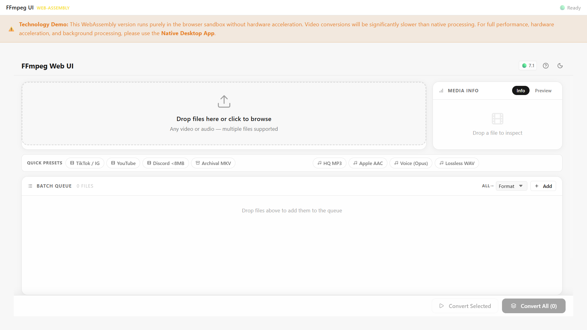
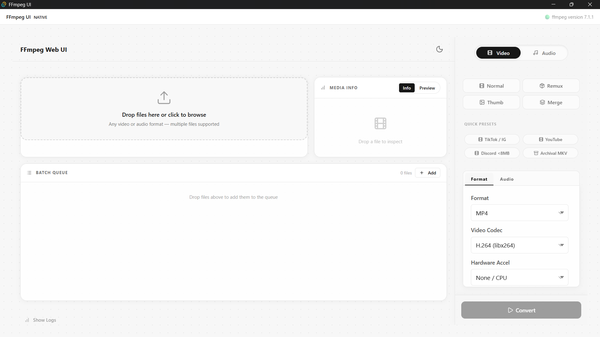

<p align="center">
  
  
</p>

<h1 align="center">FFmpeg UI</h1>

<p align="center">
  A visual interface for FFmpeg. Convert, remux, trim, and process media without touching the terminal.
</p>

<p align="center">
  <a href="https://ffmpeg-ui.vercel.app"><strong>Live web app</strong></a> ·
  <a href="https://github.com/bennypepper/FFmpeg-UI/releases/latest"><strong>Download desktop</strong></a> ·
  <a href="https://github.com/bennypepper/FFmpeg-UI"><strong>Source code</strong></a>
</p>

---

## What is it?

FFmpeg UI is a frontend for [FFmpeg](https://ffmpeg.org), the open-source media processing tool. Instead of writing command-line flags, you get a UI that builds and runs the commands for you.

It runs in three environments. All three share the same React component library (`@ffmpeg-ui/ui`) and the same validated FFmpeg command planner (`@ffmpeg-ui/core`).

---

## Platforms

### Desktop (Tauri)

An installable native app (`.msi` / `.dmg` / `.AppImage`) built with [Tauri v2](https://v2.tauri.app) and Rust.

- Direct access to your file system, no uploads and no file size limits
- Uses a system FFmpeg if one is on `PATH`; otherwise offers a one-click download of a pinned FFmpeg build that is verified against a SHA-256 checksum before use
- Native OS notifications on job completion
- Settings saved across sessions
- Hardware acceleration selector (NVIDIA CUDA, Intel QSV)
- Batch queue for processing multiple files

Source: [`apps/desktop/`](./apps/desktop/)
Download: [GitHub Releases](https://github.com/bennypepper/FFmpeg-UI/releases/latest)

---

### Browser (WebAssembly)

FFmpeg compiled to WASM, running inside your browser tab. No server involved. Files stay on your device.

- Uses [`@ffmpeg/ffmpeg`](https://github.com/ffmpegwasm/ffmpeg.wasm) v0.12 with the single-threaded `@ffmpeg/core` 0.12.6 build (FFmpeg 5.1.4)
- Supports H.264 (`libx264`), ProRes (`prores_ks`), MP3, AAC, Opus, FLAC and WAV output, remux, GIF and thumbnail extraction
- H.265, VP9/WebM and hardware acceleration are not available in the browser build. Use Desktop or the local server for those.
- Requires a one-time ~30 MB WASM download on first load, with a visible progress bar
- Requires cross-origin isolation (`COOP: same-origin` + `COEP: require-corp`), which `apps/wasm-web/vercel.json` sets in production and `vite.config.ts` sets in development

Source: [`apps/wasm-web/`](./apps/wasm-web/)
Live: [ffmpeg-ui.vercel.app](https://ffmpeg-ui.vercel.app)

---

### Local server (Python)

A Flask server processes media on the machine running it. Useful for home servers or headless setups. The web UI is the same React app (`apps/local-server-web`), built to static files that Flask serves.

| Path | Description |
|---|---|
| [`apps/local-server/`](./apps/local-server/) | Flask API (`server.py`), install and start scripts, pytest suite |
| [`apps/local-server-web/`](./apps/local-server-web/) | React UI built with Vite; Flask serves its `dist/` folder |

Requirements: Python 3.11+, Node.js (to build the UI), FFmpeg on `PATH`.

```bash
# 1. Build the UI (from the repo root, after `npm install`)
npm run build --workspace=local-server-web

# 2. Install Python dependencies
cd apps/local-server
# Windows
install_dependencies.bat
# macOS / Linux
./install_dependencies.sh

# 3. Start the server (http://127.0.0.1:5000)
# Windows
start_converter.bat
# macOS / Linux
./start_converter.sh
```

You can also start it from the repo root with `npm start --workspace=local-server`.

---

## Features

| Feature | Desktop | WASM | Local server |
|---|:---:|:---:|:---:|
| Video conversion | ✅ | ✅ | ✅ |
| Audio conversion | ✅ | ✅ | ✅ |
| Remux (no re-encode) | ✅ | ✅ | ✅ |
| Thumbnail extraction | ✅ | ✅ | ✅ |
| GIF export | ✅ | ✅ | ✅ |
| Merge / concatenate | Planned | Planned | ✅ |
| Batch queue | ✅ | ✅ | ✅ |
| Quick presets (TikTok, YouTube, Discord...) | ✅ | ✅ | ✅ |
| Media info + preview | ✅ | ✅ | ✅ |
| H.265 / VP9 encoding | ✅ | ❌ | ✅ |
| Hardware acceleration (CUDA, QSV) | ✅ | ❌ | ✅ |
| Native file system access | ✅ | ❌ | ✅ |
| No internet required | ✅¹ | ❌² | ✅ |
| No installation needed | ❌ | ✅ | ❌ |
| Files stay on your device | ✅ | ✅ | ✅ |

> ¹ Desktop needs a network connection only for the optional FFmpeg download when no system FFmpeg is installed.
> ² WASM needs an internet connection on first load to download the ~30 MB core. After that it uses the browser cache.

---

## How it works

```
┌─────────────────────────────────────────────────────────────┐
│                    packages/core                            │
│     TypeScript FFmpeg planner and validator                 │
│   planFFmpegJob(options, platform) -> { args, errors, ... } │
└───────────────────────┬─────────────────────────────────────┘
                        │ produces string[] (validated per platform)
          ┌─────────────┼─────────────┐
          ▼             ▼             ▼
   Desktop (Tauri)   WASM (Browser)  Local server
   Rust runner       ffmpeg.exec()   Python subprocess
   spawns FFmpeg     runs in WASM    runs FFmpeg
   natively          worker thread   server-side
          │             │             │
          └─────────────┼─────────────┘
                        │
                        ▼
               packages/ui
         Shared React components
         (MediaEditor, SettingsModal,
          TerminalOutput, AboutModal...)
```

`@ffmpeg-ui/core` is a framework-agnostic TypeScript package with no runtime dependencies. It validates options against per-platform capabilities (for example, it rejects `libx265` for the WASM target) and returns FFmpeg argument arrays. `@ffmpeg-ui/ui` is a React component library styled with plain CSS. Each platform app (`desktop`, `wasm-web`, `local-server-web`) consumes both packages and handles its own backend.

---

## Security notes

- **Local server:** binds to `127.0.0.1`, allows CORS only from local origins, and requires a per-boot token on API requests. It limits upload size.
- **Desktop:** strict Content Security Policy, least-privilege Tauri capabilities, asset protocol access granted per selected file instead of a global scope, FFmpeg arguments built by a typed Rust command builder, and SHA-256 verification of downloaded FFmpeg binaries.
- **WASM:** Content Security Policy plus COOP/COEP/CORP headers, and virtual filesystem cleanup after each job.

---

## Repository structure

```
FFmpeg-UI/
├── apps/
│   ├── desktop/              # Tauri v2 + React 19 (native desktop)
│   │   └── src-tauri/        #   Rust backend: command builder, jobs, downloader
│   ├── wasm-web/             # Vite + React 19 (WebAssembly browser app)
│   ├── local-server/         # Flask API, scripts, pytest suite
│   └── local-server-web/     # React 19 UI served by the Flask server
│
├── packages/
│   ├── core/                 # @ffmpeg-ui/core: FFmpeg planner + Vitest suite
│   └── ui/                   # @ffmpeg-ui/ui: shared React components
│
├── .github/
│   ├── workflows/ci.yml      # Typecheck, lint, tests, build, audit
│   ├── workflows/release.yml # Tauri installers on `v*` tags
│   └── dependabot.yml
│
├── docs/
│   ├── ARCHITECTURE_PRD.md   # Architecture notes
│   └── screenshots/
│
├── turbo.json                # Turborepo v2 task config
└── package.json              # Workspace root (npm workspaces + Turborepo)
```

---

## Getting started

### Prerequisites

| Tool | Version | Required for |
|---|---|---|
| Node.js | 20.19+ or 22.12+ | All apps (Vite 8 requirement) |
| npm | 10+ | All apps |
| Rust + Cargo | 1.80+ (stable) | Desktop only |
| Python | 3.11+ | Local server only |
| FFmpeg | any recent build | Local server, `@ffmpeg-ui/core` integration tests |

> Desktop (Tauri) requires additional setup depending on your OS. See the [Tauri v2 prerequisites guide](https://v2.tauri.app/start/prerequisites/). On Windows that means the Visual Studio C++ Build Tools and WebView2.

### 1. Clone and install

```bash
git clone https://github.com/bennypepper/FFmpeg-UI.git
cd FFmpeg-UI
npm install
```

This installs dependencies for every workspace through npm workspaces.

### 2. Run an app

```bash
# WASM app (http://localhost:5173)
npm run dev --workspace=wasm-web

# Desktop app (starts Vite and the Tauri shell; needs Rust)
npm run tauri dev --workspace=desktop

# Local server UI dev server (proxies API calls to the Flask server on :5000)
npm run dev --workspace=local-server-web
```

`npm run dev` at the repo root runs every workspace's `dev` script through Turborepo. That starts several Vite servers at once (their ports shift when 5173 is taken, and the Tauri dev URL expects 5173), so prefer the per-workspace commands above.

The WASM core (~30 MB) is copied from `@ffmpeg/core` into `apps/wasm-web/public/ffmpeg/` by a `predev` / `prebuild` script. That folder is generated and git-ignored.

The desktop app offers to download FFmpeg (~80 MB) on first launch if none is installed.

**Building an installer:**

```bash
npm run tauri build --workspace=desktop
```

Output goes to `apps/desktop/src-tauri/target/release/bundle/`.

### 3. Check your changes

```bash
npm run typecheck   # tsc across all workspaces
npm run lint        # ESLint
npm run test        # Vitest (packages/core)
npm run build       # production builds

# Python local server
pip install -r apps/local-server/requirements.txt -r apps/local-server/requirements-dev.txt
ruff check apps/local-server
pytest apps/local-server/tests

# Rust desktop backend (build the desktop frontend first so ../dist exists)
npm run build --workspace=desktop
cargo test --manifest-path apps/desktop/src-tauri/Cargo.toml
```

The `@ffmpeg-ui/core` integration tests call a real `ffmpeg` binary, so install FFmpeg first.

---

## CI and releases

- [`ci.yml`](./.github/workflows/ci.yml) runs on pushes and pull requests to `main`: typecheck, lint, tests, build and `npm audit` for the JS workspaces; Ruff and pytest for the local server; Clippy and `cargo test` for the desktop crate on Linux and Windows.
- [`release.yml`](./.github/workflows/release.yml) builds Tauri installers for Windows, macOS and Linux when a `v*` tag is pushed (or on manual dispatch) and attaches them to a draft GitHub release.
- [`dependabot.yml`](./.github/dependabot.yml) opens weekly update PRs for npm, Cargo, pip and GitHub Actions.

Keep the version in `package.json` files, `apps/desktop/src-tauri/Cargo.toml` and `apps/desktop/src-tauri/tauri.conf.json` in sync before tagging.

---

## Tech stack

### Desktop
- [Tauri v2](https://v2.tauri.app), a Rust-based native app shell
- [React 19](https://react.dev) + TypeScript
- Typed Rust command builder, job manager and verified FFmpeg downloader
- `tauri-plugin-store`, `tauri-plugin-notification`, `tauri-plugin-dialog`, `tauri-plugin-opener`

### WebAssembly
- [Vite 8](https://vite.dev) + React 19 + TypeScript
- [`@ffmpeg/ffmpeg`](https://github.com/ffmpegwasm/ffmpeg.wasm) v0.12 and `@ffmpeg/core` 0.12.6

### Local server
- Python 3.11+, Flask 3, Flask-CORS
- pytest and Ruff

### Shared packages
- `@ffmpeg-ui/core`: pure TypeScript, no runtime dependencies, tested with Vitest
- `@ffmpeg-ui/ui`: React 19 + plain CSS, no external CSS frameworks

### Monorepo tooling
- [Turborepo](https://turbo.build) v2: task runner with caching
- npm workspaces: dependency hoisting and cross-package linking

---

## License

MIT © [bennypepper](https://github.com/bennypepper)

---

## Contributing

Pull requests are welcome. For major changes, open an issue first.
The architecture is documented in [`docs/ARCHITECTURE_PRD.md`](./docs/ARCHITECTURE_PRD.md).
Run `npm run typecheck`, `npm run lint` and `npm run test` before opening a PR.
